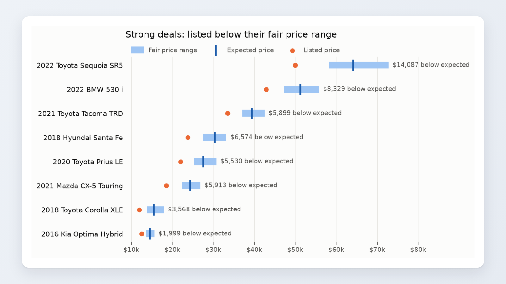
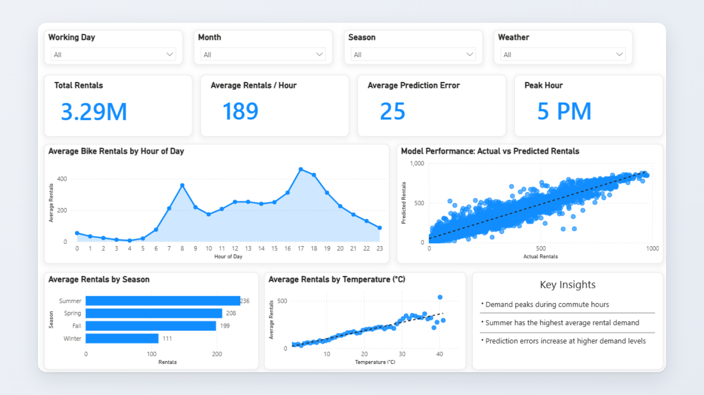
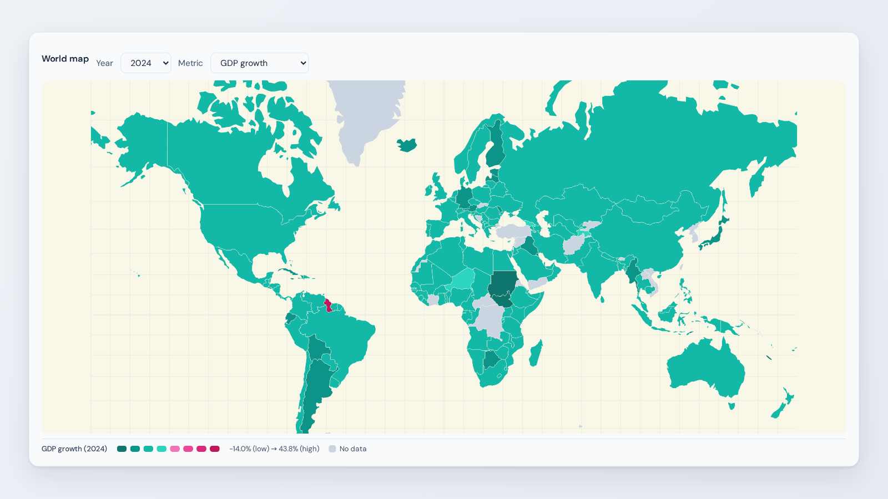
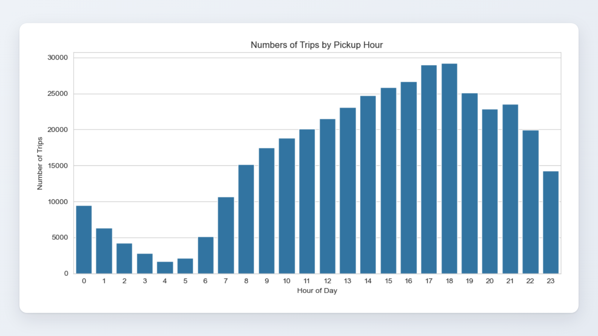

<picture>
  <source media="(prefers-color-scheme: dark)" srcset="assets/banner-dark.png">
  
</picture>

 

I'm an Applied Mathematics student at York University focused on data science. I like projects that start with messy, real-world data and end with something people can use: a model with honest error bars, a live app, or a dashboard.

- **What I do:** data cleaning, feature engineering, machine learning, SQL analysis, and turning results into apps and dashboards
- **How I work:** start from a simple baseline, compare models fairly, and explain where a model is unreliable, not just where it's accurate
- **Next up:** per-car explanations (SHAP) and a Streamlit app for my used car deal detector
- **Looking for:** data science and analytics roles

<!--
  Contact badges: replace the links below and delete these comment lines to show them.

-->

## Featured projects

<table>
<tr>
<td width="50%" valign="top">

### [Used Car Deal Detector](https://github.com/MichaelMancini9/used-car-deal-detector)

Estimates a fair price **range** for 750k used car listings and flags cars priced below it, while separating real bargains from listings that are cheap for a reason (accidents, data errors, classics).

**7.7% pricing error** vs 12.1% for a comparable-sales baseline · ranges calibrated to **80% coverage**

Python · pandas · LightGBM · quantile regression · conformal calibration

</td>
<td width="50%" valign="top">

### [Bike Sharing Demand](https://github.com/MichaelMancini9/Bike-Sharing)

Predicts hourly bike rental demand from weather and time of day. Compared five models with cross-validation, then shipped the best one as an app, an API and a dashboard.

**R² 0.93** (Random Forest) · [**Live demo**](https://bike-sharing-wyhns57zrmhi7vahzdzyvq.streamlit.app/) · FastAPI endpoint · Power BI dashboard

Python · scikit-learn · XGBoost · Streamlit · FastAPI · Power BI

</td>
</tr>
<tr>
<td width="50%" valign="top">

### [Global Development Dashboard](https://github.com/CMSOTO2/global-development-dashboard)

Full-stack dashboard for exploring GDP growth, inflation, life expectancy and poverty across 217 countries. Team project with [@CMSOTO2](https://github.com/CMSOTO2): **I built the data pipeline**, cleaning and reshaping World Bank data and loading it into the SQLite database behind the API.

[**Live app**](https://global-development-dashboard-production.up.railway.app/)

Python · pandas · SQLite · React / TypeScript (frontend by teammate)

</td>
<td width="50%" valign="top">

### [NYC Taxi Analysis](https://github.com/MichaelMancini9/NYC-TAXI-SQL)

SQL analysis of NYC taxi trips: when demand peaks, how boroughs differ, and what really drives fares.

Demand peaks at **5–6 PM** · fares follow **distance far more than time** · Manhattan has the highest fare per mile

SQL (SQLite) · Python · pandas · seaborn

</td>
</tr>
</table>

**Also:** [Telecom Customer Churn Prediction](https://github.com/MichaelMancini9/Telecom-Customer-Churn-Prediction): Random Forest classifier (ROC-AUC 0.84) showing contract type, tenure and monthly charges drive churn.

## Tools

